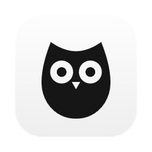
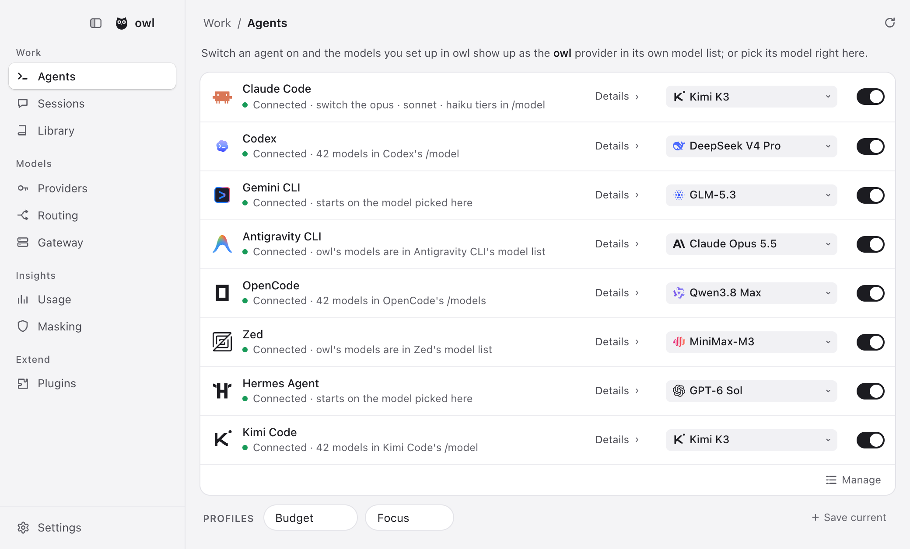
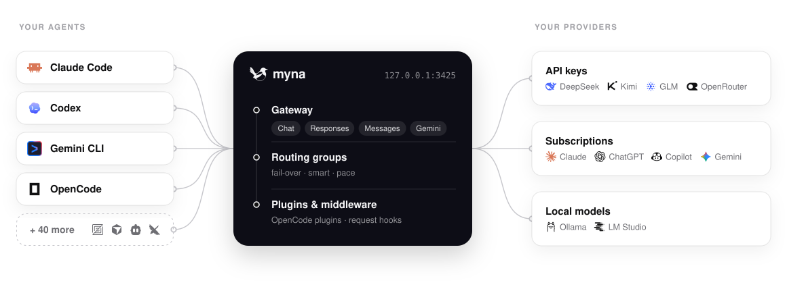
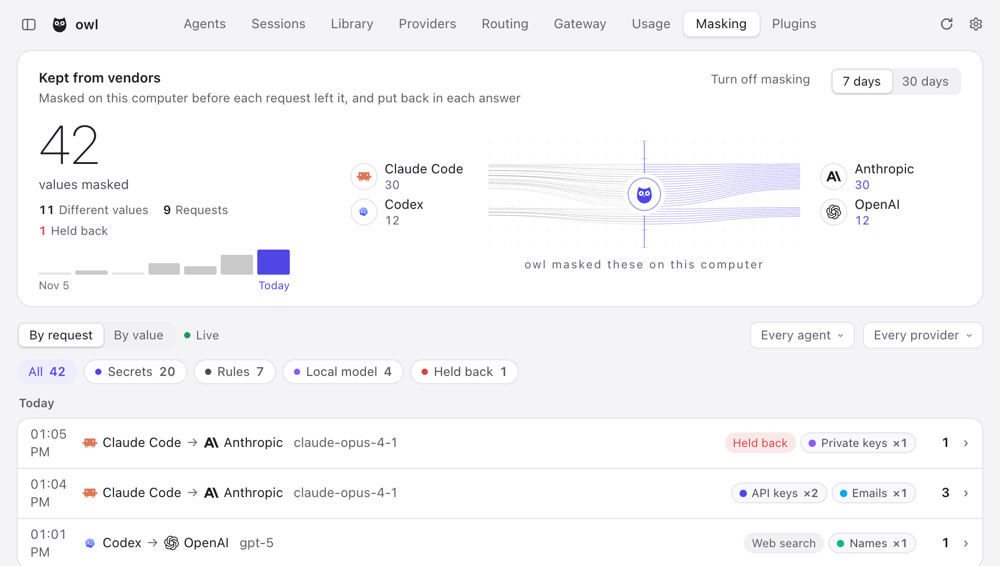
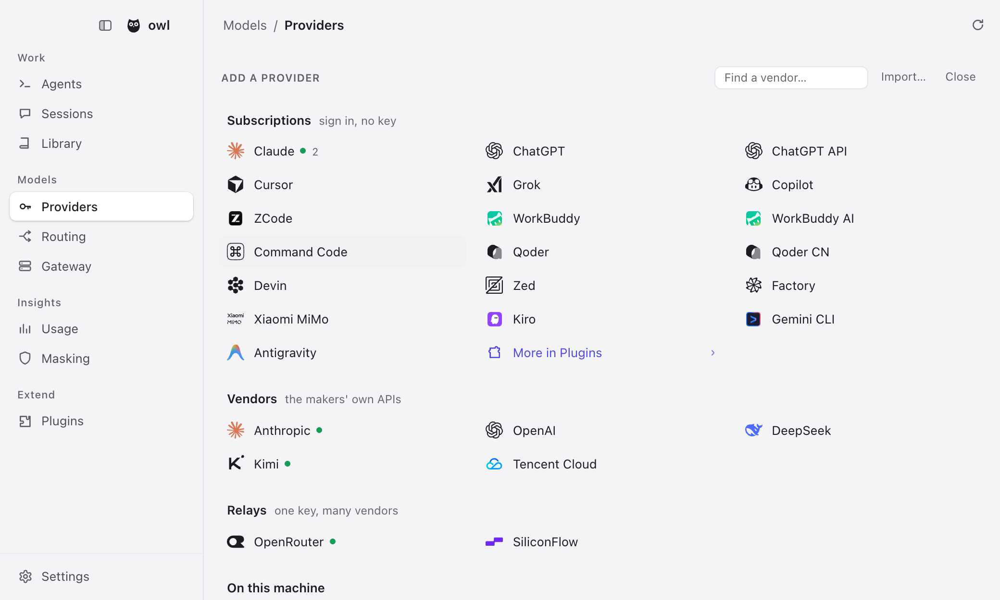
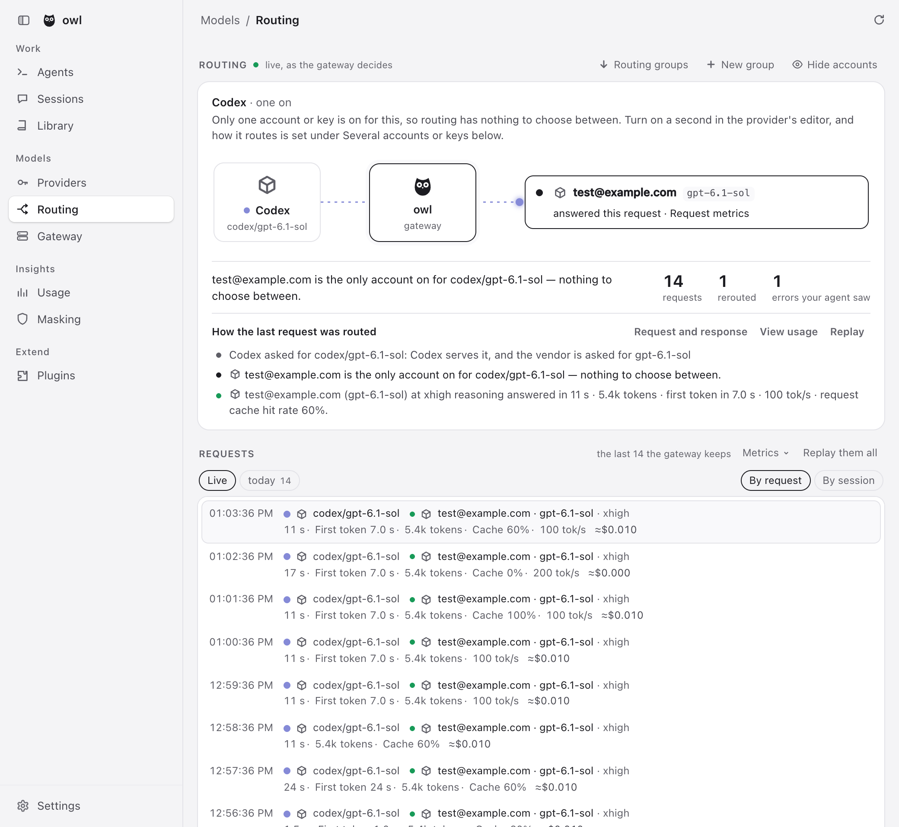
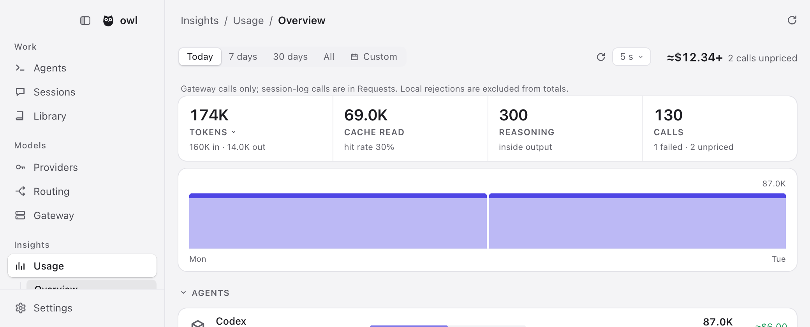

<div align="center">

<a href="https://github.com/istoo/owl"></a>

# owl

### Every agent's model. One place.

**Claude Code on Kimi. Codex on DeepSeek. Gemini CLI on GLM. OpenCode on your ChatGPT plan.**<br>
Pick any of them for any agent, from one list. One local gateway serves them all,<br>
and when a quota runs out it moves on to your next account.

> **owl is a secondary development of [yetone/magpie](https://github.com/yetone/magpie).**
> It is a derived distribution: the plugin ecosystem and contracts (`magpie` plugin key,
> `@magpie-community/*`, `X-Magpie-*` headers) are kept, while branding, the update feed and
> network dependencies are maintained independently. The original project's copyright and
> MIT license are retained.

[](https://github.com/istoo/owl/releases/latest) [](https://github.com/istoo/owl/stargazers) [](LICENSE)<br>
    

**[Download](https://github.com/istoo/owl/releases/latest)** &nbsp;·&nbsp; **[Docs](https://github.com/istoo/owl/blob/main/site/public/docs/start.html)** &nbsp;·&nbsp; **[Reference](docs/reference.md)** &nbsp;·&nbsp; **[Plugins](https://github.com/magpie-community/plugins)** &nbsp;·&nbsp; [简体中文](README.zh-CN.md)

<br>

<picture>
  <source media="(prefers-color-scheme: dark)" srcset="site/public/img/agents-dark.png">
  
</picture>

</div>

<br>

## Why owl

Every agent keeps its model in a file of its own, in its own format, with its own keys and base URLs. A subscription you pay for works in one agent and nowhere else. owl puts all of that behind one app and one local gateway:

- **Any model, any agent.** Pick from one list; owl edits the one key that matters in the agent's own config, leaving its comments and layout as they were.
- **One provider everywhere.** An API key, a local model, or the Claude, ChatGPT, Copilot, Gemini or Grok plan you are already signed in to.
- **Keep going when a quota runs out.** Another account of the same provider takes over, and a routing group moves on to another model or provider, so the agent never sees the error. With one account and no group there is nothing to move to, and the error reaches the agent.
- **Keep secrets off the vendor's servers.** With masking on, keys, passwords and emails in a prompt are swapped for placeholders on your computer, and put back in the reply.

owl is for you if you use more than one agent, more than one provider, or more than one account. If one agent on its vendor's own plan is enough, you don't need it.

Runs on macOS, Windows and Linux (menu bar app, window, TUI, web UI and CLI), in Docker, and on Termux.

## Install

Download the app from **[Releases](https://github.com/istoo/owl/releases/latest)**, or run:

```sh
curl -fsSL https://github.com/istoo/owl/releases/latest/download/install.sh | sh
```

<sub>On a desktop the script installs the app. On Linux without WebKitGTK 4.1 it installs that first with your package manager (sudo asks for your password); with no desktop, or no terminal to ask at, it installs the terminal build and says which package to add. `--gui` or `--tui` chooses. Behind a firewall, use `--proxy` or `--mirror`. The files named `owl-cli-*` are terminal builds — executables, not documents: `chmod +x` one and run it, or let the script above put `owl` on your PATH. The app is `owl-darwin-*.zip`. Or `go install github.com/istoo/owl@latest`, or the [Docker image](https://github.com/istoo/owl/blob/main/site/public/docs/docker.html). Every build updates itself and its release notes come from this repository. To remove it, run the same command with `sh -s -- --uninstall`; your settings in `~/.config/owl` stay unless you add `--purge`, which disconnects your agents and deletes them too.</sub>

## Quick start

1. **Add a provider.** Open owl and go to **Providers → Add provider**. Pick a preset and paste a key, or sign in with a subscription.
2. **Pick a model** for each agent on the **Agents** page. Start a new session and it is on the new model.
3. **Or do it from the terminal:**

```sh
owl provider add deepseek sk-…              # a preset needs only the key
owl claude deepseek/deepseek-v4-pro          # Claude Code on DeepSeek
owl codex moonshot/kimi-k2.5                 # Codex on Kimi
owl group add "Opus anywhere" models=claude/claude-opus-5-5,copilot/claude-opus-5.5 routing=smart
owl claude group/opus-anywhere               # fails over between subscriptions
owl save work && owl use work                # profiles
owl quota                                    # what's left on every plan
owl settings set theme dark                  # every Settings switch, from the terminal
owl tui                                      # the whole thing, in a terminal
```

owl finds the subscriptions your agents are signed in to by reading their sign-ins (Claude Code's and Codex's files, the Keychain). To keep it from reading them, turn off **Settings → Privacy → Subscription accounts**, or run `owl accounts discovery off` (`on` turns it back on). `OWL_NO_ACCOUNTS=1` turns it off for one run without changing the saved setting. API-key providers work either way.

## How it fits together

The gateway at `127.0.0.1:3425` speaks OpenAI Chat, OpenAI Responses, Anthropic Messages and Gemini, and translates between them — streaming, tool calls and reasoning included. Agents point at it; routing groups, plugins and the mask sit in the path.

<picture>
  <source media="(prefers-color-scheme: dark)" srcset="site/public/img/architecture-dark.svg">
  
</picture>

Anything else that takes a base URL can use the gateway too:

```sh
export OPENAI_BASE_URL=http://127.0.0.1:3425/v1     OPENAI_API_KEY=owl
export ANTHROPIC_BASE_URL=http://127.0.0.1:3425     ANTHROPIC_API_KEY=owl
export GOOGLE_GEMINI_BASE_URL=http://127.0.0.1:3425 GEMINI_API_KEY=owl
```

## What it does

### Privacy masking

Agents put what they read into the prompt: an `.env`, a config file, a log with a token in it. With masking on, owl swaps those values for placeholders on your computer before a request leaves it, and swaps them back in the reply. Your agent and your files keep the real values; the vendor never sees them.

<picture>
  <source media="(prefers-color-scheme: dark)" srcset="site/public/img/masking-dark.png">
  
</picture>

| | |
| :-- | :-- |
| **Found two ways** | Rules for what is certain (API keys, private keys, tokens, emails, and card and ID numbers whose checksum adds up), and, if you want it, a model on this computer for the names, addresses and passwords no rule can find (a 1.6 GB download, on the CPU) |
| **Put back everywhere** | A value becomes a placeholder such as `{{API_KEY_k3v9x2mq}}`, and every placeholder in the reply turns back into its value — streamed text and tool-call arguments too, so a command the agent runs has the real key |
| **Nothing breaks** | A value gets the same placeholder every time, so the conversation, the prompt cache and thinking signatures stay valid. A value masked once is masked wherever it shows up later |
| **Never on disk** | Values are held in memory only. The record keeps each value's kind, length and first characters. If masking is on and cannot run, the request is held back (503) rather than sent as written |
| **You can check it** | **Insights › Masking** lists every request it changed, with what the vendor got instead, side by side; **Try it** in Settings shows what a text would become |
| **Your rules** | Secrets and personal data each on or off, finer kinds (passport, IBAN, MAC, public IP…), your own words and patterns, and whether a value is masked, only warned about, or held back (**Mask**, **Warn**, **Block**) |

The cost: the model sees `{{API_KEY_…}}`, not the key, so a task about the value itself (why is this token refused?) cannot be done on it. Put such values under **Never mask**. Rules can be wrong now and then; the Masking page is where you would see it. It is off until you turn it on in **Settings → Privacy**. Emails at names kept for examples (`example.com`, `.test`, `.invalid`) are left as written.

### Providers and subscriptions

Pick a preset and paste a key. Model lists come from the vendor, with names and reasoning levels filled in from [models.dev](https://models.dev), so a model released this morning is in your picker on the next refresh.

> **Presets include** Anthropic · OpenAI · Google Gemini · Google Vertex AI · Amazon Bedrock (runtime and Mantle) · DeepSeek · Kimi · Zhipu GLM · MiniMax · StepFun · LongCat · Qwen · Baidu Qianfan · Tencent Cloud · Huawei Cloud MaaS · Volcengine Ark · Mistral · Groq · Nous Portal · xAI · OpenRouter · Together · Fireworks · SiliconFlow · NVIDIA NIM · ModelScope · Ollama · LM Studio … and any OpenAI- or Anthropic-compatible URL.

**Import** brings in the providers from CC Switch, Claude Code, Codex and Alma. **[Add to owl](https://github.com/istoo/owl/blob/main/site/public/docs/import.html)** links let a provider's website hand its config to owl in one click. Each key and each account can go through a proxy of its own.

An agent you are signed in to is a **subscription** with models behind it, so owl offers it as a provider to every other agent. Add several accounts per subscription and owl fails over between them.

- **Claude**: drives the real local `claude` binary and bridges your agent's tools over MCP
- **Codex / ChatGPT**: your ChatGPT plan's models, in every other agent
- **GitHub Copilot**, **Gemini (Code Assist)**, **Antigravity**, **Grok (SuperGrok)** and more
- **Any OpenCode auth plugin or pi package** from npm

**Daily warm-up** starts each Claude and ChatGPT account's 5-hour window at the times you choose, or the moment the last one resets.

<picture>
  <source media="(prefers-color-scheme: dark)" srcset="site/public/img/add-dark.png">
  
</picture>

### Routing groups

A **routing group** is several models an agent picks as one, such as `group/daily-coding`. The gateway spreads requests over every member's keys and accounts:

| Mode | What it does |
| :-- | :-- |
| **`smart`** | Of the subscriptions with quota left, use the one that renews soonest, so less is wasted at the reset |
| **`order`** | Use the first model until it cannot answer, then the next |
| **`rotate`** | Move to the next member on each turn |
| **`usage`** | Use the least-used member first |
| **`pace`** | Use the account with the most of its week left per hour until it resets |

A conversation **stays with the account that answered it** while the vendor's prompt cache is worth keeping. Groups can contain groups. **[Intent routing](https://github.com/istoo/owl/blob/main/site/public/docs/intent.html)** has a small model of your choice read each new turn, so tests go to the strong model and quick questions to the cheap one. The Routing view shows every decision live.

<picture>
  <source media="(prefers-color-scheme: dark)" srcset="site/public/img/routing-dark.png">
  
</picture>

### Plugins

```sh
owl plugin add opencode-gemini-auth   # an OpenCode plugin from npm
owl plugin add pi-antigravity         # a pi package, the same way
owl plugin login google-plugin        # its own sign-in flow, in owl
```

Plugins run on [Bun](https://bun.sh), downloaded the first time one needs it. A plugin signs in, lists its models and makes each request; agents use those models like any other provider's. Browse **[magpie-community/plugins](https://github.com/magpie-community/plugins)**, or [write your own](https://github.com/istoo/owl/blob/main/site/public/docs/plugins.html).

A plugin can also be **gateway middleware**: JavaScript that sees what every agent sends and gets back. `onRequest` can rewrite a request or turn it away, `onEvent` sees each streamed event, `onResponse` the whole reply. A hook that throws or runs too long leaves the request as it was.

```js
// alias.middleware.js — owl plugin add ./alias.middleware.js
export function onRequest(body, ctx) {
  if (body.model === "fast") return { ...body, model: "deepseek/deepseek-chat" };
}
```

<details>
<summary><b>Ready-made middleware</b>, most of it what <a href="https://github.com/QuantumNous/new-api">New API</a> does for its channels, with the same JSON</summary>

<br>

| Package | What it does |
| :-- | :-- |
| `param-override` | New API's `param_override`: set, delete, move or rewrite request fields, under conditions, or turn a request away |
| `model-map` | New API's `model_mapping`: send a model under another name; replies keep the name asked for |
| `system-prompt` | Your system prompt on every request, or some agents' or models' |
| `word-guard` | New API's sensitive-word filter: turn away or mask words in what users send, and in replies |
| `think-tags` | Take ` thinking…` out of replies, or put `reasoning_content` into them |

```sh
owl plugin add @magpie-community/middleware-model-map
owl plugin options model-map '{"mapping": {"fast": "deepseek/deepseek-chat"}}'
```

Find them under Plugins › Discover › Gateway middleware. See [Gateway middleware](https://github.com/istoo/owl/blob/main/site/public/docs/plugins.html#middleware).

</details>

### Usage, sharing and everything else

<picture>
  <source media="(prefers-color-scheme: dark)" srcset="site/public/img/usage-dark.png">
  
</picture>

| | |
| :-- | :-- |
| **Tokens and cost** | Tokens, cache reads and writes, reasoning and calls, with cost at list price in dollars or yuan; set your own price for any model |
| **Quota** | Balances and quota windows for every key, plan and account (`owl quota`), and a reminder before a window renews with much of it unused |
| **Sessions** | Every agent conversation with its cost and title, reopened in your terminal with one click |
| **Context** | How full each request's context window is, how much came from the cache, and what fills it |
| **Bills** | By account and by upstream key, and OTLP export to your own observability stack |
| **Local network** | Turn on *Share on local network* and give each client a named gateway key with its own daily, weekly or monthly token and cost limit |
| **[Remote owl](https://github.com/istoo/owl/blob/main/site/public/docs/remote.html)** | A laptop uses the providers, accounts and groups of the owl on your desktop, and still wires its own agents |
| **[Docker](https://github.com/istoo/owl/blob/main/site/public/docs/docker.html)** | Run `ghcr.io/istoo/owl` on a server or a NAS and manage it from the web UI |
| **Sync** | Back up to a file, or sync machines over WebDAV (Nutstore, Nextcloud…), S3, or an encrypted GitHub repository backup |

- **Library**: write instructions, MCP servers, skills and subagents once; owl writes them into each agent's files in its format, and removes only what it wrote.
- **Web search for any model**: a model that cannot search gets owl's search — a provider that can, or search APIs (Tavily, Brave, Exa, Firecrawl, You.com, DeepSeek, Doubao Search, Yuanbao Search, SearXNG), in the order you drag them. Any agent can mount the same search as an MCP server, with `web_search` and `web_fetch`.
- **Images and video**: an image tool for any agent over MCP, with the model you choose, and videos with a Grok subscription or a MiniMax API key.
- **Agents kept current**: the Agents page shows each CLI's version, updates it the way it was installed, and gives the commands for the ones you don't have.
- **WSL**, **keep awake**, light and dark, and your theme's look on [Omarchy](https://omarchy.org).

## Supported agents

<table>
<tr><td>

Claude Code · Claude Desktop · Claude Science · Codex · Gemini CLI · Antigravity CLI · OpenCode · OpenChamber · MiMo Code · DevEco Code · Pi · oh-my-pi · StepCode · MothX · PenguinHarness · Aside · OmO · Prime Agent · Goose · Cursor CLI · Cursor Private Inference · Zed · VS Code Chat · VS Code Insiders · VSCodium Chat · Zoo Code · JetBrains Air · Air (JetBrains IDEs) · Copilot (JetBrains) · Copilot CLI · Crush · DeepSeek Harness · Reasonix Studio · Command Code · fx · Devin · Hermes Agent · Mister Morph · Kimi Code · jcode · Qwen Code · Muse Code · Empryo · MiniMax Code · Droid · Cline · Qoder · Qoder CN · Grok Build · Grok App · ZCode · WorkBuddy · WorkBuddy AI · CodeBuddy · Pencil · OpenPencil · OpenBot · NewMax · Raycast · Kiro Crew · T3 Code · OpenHanako · AtomCode · Snow CLI · Alma · Cindy · Lody · AionUi · Ante · AstrBot · QwenPaw · OpenClaw

</td></tr>
</table>

owl shows only the agents installed on your machine; setup notes for some of them are in the [reference](docs/reference.md#notes-on-some-agents).

## Documentation

| | |
| :-- | :-- |
| **[Get started](https://github.com/istoo/owl/blob/main/site/public/docs/start.html)** | The guided tour |
| **[Reference](docs/reference.md)** | Every agent, provider option, gateway endpoint, CLI command and file |
| **[Plugins](https://github.com/istoo/owl/blob/main/site/public/docs/plugins.html)** | Use plugins and write your own |
| **[Intent routing](https://github.com/istoo/owl/blob/main/site/public/docs/intent.html)** | Route each turn by what it asks for |
| **[Import links](https://github.com/istoo/owl/blob/main/site/public/docs/import.html)** | "Add to owl" buttons for provider websites |
| **[Remote owl](https://github.com/istoo/owl/blob/main/site/public/docs/remote.html)** | Use one owl's providers and groups from your other computers |
| **[Docker](https://github.com/istoo/owl/blob/main/site/public/docs/docker.html)** | Run owl on a server or a NAS |

## Privacy

Your prompts, replies, keys and accounts go only to the providers you use, and with [privacy masking](#privacy-masking) on, the secrets in them do not go even there. This build of owl reports nothing to upstream: no usage event, no partner list, no icon proxy. Its updates, release notes and the pictures it shows come from, or go to, no service but this GitHub repository.

## Community

Questions, ideas, or a model that will not show up? **[Open an issue](https://github.com/istoo/owl/issues)**. That is where feedback goes.

**This repository does not take pull requests.** Only maintainers can open them. If you would like a fix or a feature, describe it in an issue and we will build it.

If owl saved you from editing one more config file, **a ⭐ helps others find it.**

<a href="https://star-history.com/#istoo/owl&Date">
  <picture>
    <source media="(prefers-color-scheme: dark)" srcset="https://api.star-history.com/svg?repos=istoo/owl&type=Date&theme=dark">
    
  </picture>
</a>

## License

[MIT](LICENSE)

owl is not affiliated with [Apache Owl](https://owl.apache.org) or the [Apache Software Foundation](https://apache.org).
