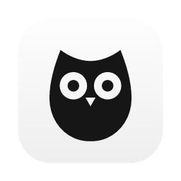
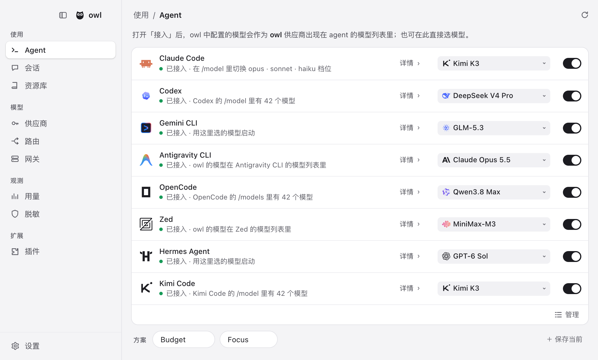
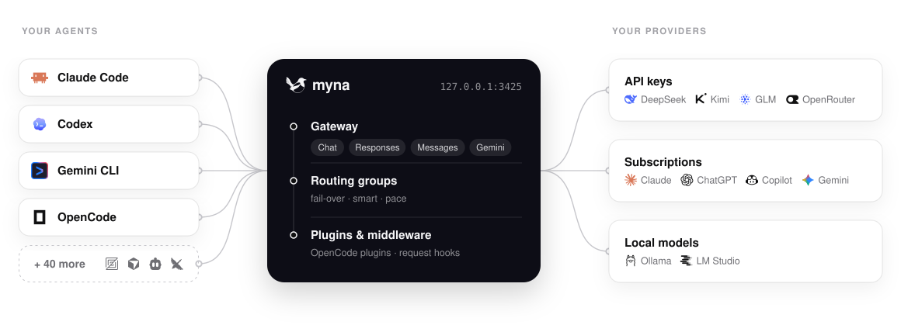
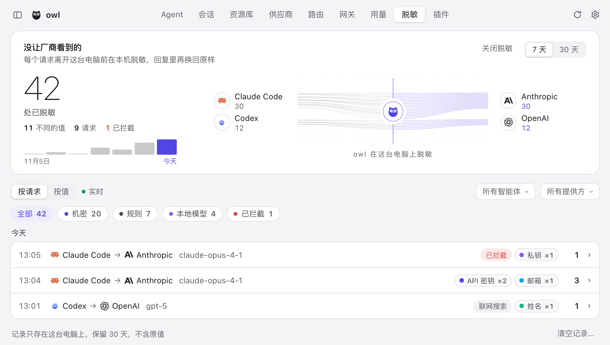
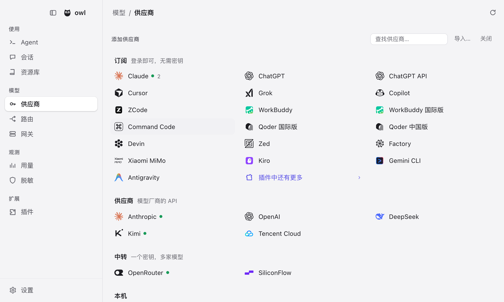
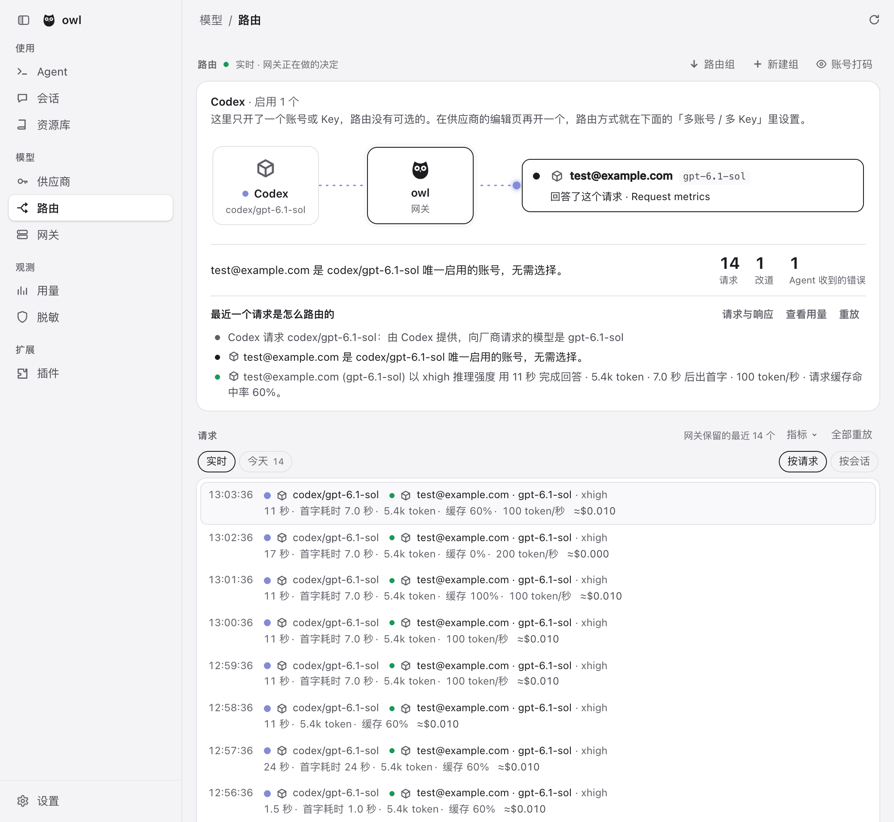
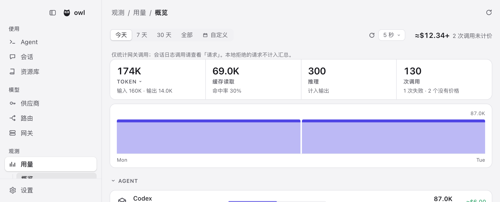

<div align="center">

<a href="https://github.com/istoo/owl"></a>

# owl

### 你的 agent，你的模型，一个控制台。

**Claude Code 用 Kimi，Codex 用 DeepSeek，Gemini CLI 用 GLM，OpenCode 用你的 ChatGPT 套餐。**<br>
所有 agent 都从同一份清单里取模型。一个本地网关把它们全部接住，<br>
额度见底之前就换到你的下一个账号。

[](https://github.com/istoo/owl/releases/latest) [](https://github.com/istoo/owl/stargazers) [](LICENSE)<br>
    

**[下载](https://github.com/istoo/owl/releases/latest)** &nbsp;·&nbsp; **[文档](https://github.com/istoo/owl/blob/main/site/public/docs/zh/start.html)** &nbsp;·&nbsp; **[完整参考（英文）](docs/reference.md)** &nbsp;·&nbsp; **[插件](https://github.com/magpie-community/plugins)** &nbsp;·&nbsp; [English](README.md)

<br>

<picture>
  <source media="(prefers-color-scheme: dark)" srcset="site/public/img/agents-zh-dark.png">
  
</picture>

</div>

<br>

## owl 是什么

每个 agent 都要求把模型放在自己的地方：另一个文件、另一个键、另一个 base URL。你付费的订阅通常只接进其中一个 agent，想再接一个，就得手动改配置。

owl 把这些事收到一个界面里。给某个 agent 选一个模型，owl 只重写决定模型的那一项设置，注释和排版不动。之后所有请求都从本地网关出去，故障切换、路由、隐私脱敏和用量统计只在一个地方做，对所有 agent 生效。

如果你同时用多个 agent、多个供应商，或者同一供应商的多个账号，owl 才有意义。只是一个 agent 配它自己的套餐，那用 agent 自己的设置就够了。

它支持 macOS、Windows 和 Linux，有菜单栏应用、窗口、TUI、Web UI 和 CLI；也能跑在 Docker 和 Termux 里。

## 安装

从 **[Releases](https://github.com/istoo/owl/releases/latest)** 下载应用，或者：

```sh
curl -fsSL https://github.com/istoo/owl/releases/latest/download/install.sh | sh
```

<sub>有桌面时，脚本装的是应用。Linux 上没有 WebKitGTK 4.1 时，脚本会先用你的包管理器装上（sudo 会问密码）；没有桌面、或者没有终端可以应答，它就装终端版，并告诉你还缺哪个包。想指定装哪个，加 `--gui` 或 `--tui`。在防火墙后面，加 `--proxy` 或 `--mirror`。叫 `owl-cli-*` 的文件是终端版，不是文档：`chmod +x` 之后直接运行，或者让脚本把 `owl` 放进 PATH。桌面应用是 `owl-darwin-*.zip`。也可以 `go install github.com/istoo/owl@latest`，或者用 [Docker 镜像](https://github.com/istoo/owl/blob/main/site/public/docs/zh/docker.html)。每个构建都会自更新，更新说明来自这个仓库。卸载就用同一条命令加 `sh -s -- --uninstall`；`~/.config/owl` 里的设置会留下，除非再加 `--purge`，那会连你的 agent 一起断开并删除。</sub>

**macOS 第一次打开。** 应用是 ad hoc 签名，没有公证。浏览器下载的副本带 quarantine 标记，macOS 会拒绝运行，直到你在 **系统设置 → 隐私与安全性** 里点 **仍要打开**，或者执行 `/usr/bin/xattr -dr com.apple.quarantine /Applications/owl.app`。用上面的脚本装的副本走 `curl`，没有这个标记，直接就能打开。

## 快速开始

1. **添加供应商。** 在 owl 里打开 **供应商 → 添加供应商**，选一个预设、粘贴 key，或者登录一个订阅。
2. **给每个 agent 选模型**，在 **Agents** 页面。之后新开的会话就用它。
3. **或者留在终端里：**

```sh
owl provider add deepseek sk-…              # 预设只要 key
owl claude deepseek/deepseek-v4-pro          # Claude Code 用 DeepSeek
owl codex moonshot/kimi-k2.5                 # Codex 用 Kimi
owl group add "Opus anywhere" models=claude/claude-opus-5-5,copilot/claude-opus-5.5 routing=smart
owl claude group/opus-anywhere               # 在订阅之间故障切换
owl save work && owl use work                # 配置档
owl quota                                    # 每个套餐还剩多少
owl settings set theme dark                  # 终端里改每一项设置
owl tui                                      # 整个产品装进终端
```

owl 会读取 agent 的登录记录（Claude Code 和 Codex 的文件、钥匙串），据此发现你已经登录的订阅。不想让它读，关掉 **设置 → 隐私 → 订阅账号**，或者运行 `owl accounts discovery off`（`on` 恢复）。`OWL_NO_ACCOUNTS=1` 只关掉这一次运行，不动已保存的设置。API key 供应商两种情况下都照常可用。

## 各部分怎么连起来

网关监听 `127.0.0.1:3425`。它接收 OpenAI Chat、OpenAI Responses、Anthropic Messages 和 Gemini 请求，并在这些格式之间翻译，流式、工具调用和推理都在其中。你的 agent 指向它；路由组、插件和隐私脱敏都在路上。

<picture>
  <source media="(prefers-color-scheme: dark)" srcset="site/public/img/architecture-dark.svg">
  
</picture>

任何能填 base URL 的程序也能走这个网关：

```sh
export OPENAI_BASE_URL=http://127.0.0.1:3425/v1     OPENAI_API_KEY=owl
export ANTHROPIC_BASE_URL=http://127.0.0.1:3425     ANTHROPIC_API_KEY=owl
export GOOGLE_GEMINI_BASE_URL=http://127.0.0.1:3425 GEMINI_API_KEY=owl
```

## 它能做什么

### 隐私脱敏

agent 读了 `.env`、配置文件或者带 token 的日志，这些内容就会进入提示词。打开脱敏后，owl 在请求离开本机之前把这些值换成占位符，再把回复里的占位符还原。你的 agent 和文件看到的仍是原值，供应商看不到。

<picture>
  <source media="(prefers-color-scheme: dark)" srcset="site/public/img/masking-zh-dark.png">
  
</picture>

| | |
| :-- | :-- |
| **两种识别方式** | 形状确定的值由规则抓：API key、私钥、token、邮箱，以及校验和成立的卡号和证件号。规则认不出的姓名、地址和密码，可以交给在这台电脑上跑的一个模型（1.6 GB 下载，用 CPU） |
| **处处还原** | 值变成 `{{API_KEY_k3v9x2mq}}` 这样的占位符。回复里每个占位符都换回真值，流式文本和工具调用参数也不例外，所以 agent 执行的命令用的是真 key |
| **跨回合稳定** | 同一个值永远得到同一个占位符，对话、提示词缓存和 thinking 签名因此保持有效。一个值被脱敏过，之后出现在哪里都继续脱敏 |
| **只在内存** | 值只存在内存里，记录里只有种类、长度和前几个字符。脱敏开着却跑不起来时，请求会被拦下并返回 503，不会按原样发出去 |
| **看得见、查得到** | **观测 › 脱敏** 列出每个被改过的请求，和供应商实际收到的内容并排；设置里的 **试一试** 能看一段文字会变成什么样 |
| **可调整** | 密钥和个人数据可以分开开关，细到单个种类（护照、IBAN、MAC、公网 IP……），还能加自己的词和模式。每个值可以脱敏、只警告或者拦截（**脱敏**、**警告**、**拦截**） |

代价是：模型看到的是 `{{API_KEY_…}}`，不是 key 本身，所以需要针对这个值本身的任务（比如为什么这个 token 被拒）做不了。这类值放进 **从不脱敏**。规则偶尔会出错，**脱敏** 页面就是让你发现它的地方。脱敏默认关闭，要在 **设置 → 隐私** 里打开。示例专用域名（`example.com`、`.test`、`.invalid`）下的邮箱原样通过。

### 供应商和订阅

选一个预设，粘贴 key。模型清单由供应商提供，名称和推理档位从 [models.dev](https://models.dev) 补全，所以今早发布的模型，下次刷新就出现在选择器里。

> **预设包括** Anthropic · OpenAI · Google Gemini · Google Vertex AI · Amazon Bedrock（runtime 和 Mantle）· DeepSeek · Kimi · 智谱 GLM · MiniMax · StepFun · LongCat · 通义千问 · 百度千帆 · 腾讯云 · 华为云 MaaS · 火山方舟 · Mistral · Groq · Nous Portal · xAI · OpenRouter · Together · Fireworks · SiliconFlow · NVIDIA NIM · ModelScope · Ollama · LM Studio ……以及任何 OpenAI 或 Anthropic 兼容的 URL。

**导入** 能把 CC Switch、Claude Code、Codex 和 Alma 里的供应商搬过来。**[Add to owl](https://github.com/istoo/owl/blob/main/site/public/docs/zh/import.html)** 链接让供应商官网一键把配置交给 owl。每个 key、每个账号都可以单独走代理。

你已经登录的 agent 会作为一个带模型的**订阅**出现，owl 把它当供应商提供给其他所有 agent。一个订阅下可以加多个账号，owl 在它们之间故障切换。

- **Claude**：驱动本机真实的 `claude` 二进制，并通过 MCP 桥接你 agent 的工具
- **Codex / ChatGPT**：你 ChatGPT 套餐里的模型，其他每个 agent 都能用
- **GitHub Copilot**、**Gemini（Code Assist）**、**Antigravity**、**Grok（SuperGrok）** 等
- **npm 上的任何 OpenCode 认证插件或 pi 包**

**每日预热** 在你选的时间，或者上一个窗口刚重置的时候，开启每个 Claude 和 ChatGPT 账号的 5 小时窗口。

<picture>
  <source media="(prefers-color-scheme: dark)" srcset="site/public/img/add-zh-dark.png">
  
</picture>

### 路由组

**路由组**把几个模型捆在一个名字下，agent 把它当成一个来选，比如 `group/daily-coding`。网关把请求分摊到每个成员的 key 和账号上：

| 模式 | 做什么 |
| :-- | :-- |
| **`smart`** | 在还有额度的订阅里，挑最快重置的那个，重置时浪费最少 |
| **`order`** | 一直用第一个模型，答不了再换下一个 |
| **`rotate`** | 每回合前进到下一个成员 |
| **`usage`** | 先用得最少的那个 |
| **`pace`** | 优先用每小时剩余周额度最多的账号，直到它重置 |

只要供应商的提示词缓存还值得保留，一段对话就**留在回答它的账号上**。组里可以套组。**[意图路由](https://github.com/istoo/owl/blob/main/site/public/docs/zh/intent.html)** 让你挑一个小模型读每个新回合，测试交给强模型，随口的问题交给便宜的。路由页面实时显示每一次决策。

<picture>
  <source media="(prefers-color-scheme: dark)" srcset="site/public/img/routing-zh-dark.png">
  
</picture>

### 插件

```sh
owl plugin add opencode-gemini-auth   # npm 上的 OpenCode 插件
owl plugin add pi-antigravity         # pi 包，同样方式
owl plugin login google-plugin        # 它自己的登录流程，在 owl 里完成
```

插件跑在 [Bun](https://bun.sh) 上，第一次用到时自动下载。插件负责登录、列出模型、发出请求；agent 像用别的供应商一样用这些模型。到 **[magpie-community/plugins](https://github.com/magpie-community/plugins)** 找，或者[自己写一个](https://github.com/istoo/owl/blob/main/site/public/docs/zh/plugins.html)。

插件也能当**网关中间件**：一段能看见每个 agent 发出和收回什么的 JavaScript。`onRequest` 可以改写请求或拒绝它，`onEvent` 观察每个流式事件，`onResponse` 看到完整回复。hook 抛异常或者跑太久，请求就原样通过。

```js
// alias.middleware.js — owl plugin add ./alias.middleware.js
export function onRequest(body, ctx) {
  if (body.model === "fast") return { ...body, model: "deepseek/deepseek-chat" };
}
```

<details>
<summary><b>现成的中间件</b>，大多是 <a href="https://github.com/QuantumNous/new-api">New API</a> 对渠道做的事，JSON 也一样</summary>

<br>

| 包 | 做什么 |
| :-- | :-- |
| `param-override` | New API 的 `param_override`：在条件下设置、删除、移动或改写请求字段，也可以拒绝请求 |
| `model-map` | New API 的 `model_mapping`：用另一个名字发模型，回复仍用请求时的名字 |
| `system-prompt` | 给每个请求加上你的系统提示词，或者只给某些 agent、某些模型 |
| `word-guard` | New API 的敏感词过滤：拦截或遮盖用户发出的词，回复里的也算 |
| `think-tags` | 把 ` thinking…` 从回复里去掉，或者往回复里加 `reasoning_content` |

```sh
owl plugin add @magpie-community/middleware-model-map
owl plugin options model-map '{"mapping": {"fast": "deepseek/deepseek-chat"}}'
```

在 插件 › 发现 › 网关中间件 里能找到它们。见[网关中间件](https://github.com/istoo/owl/blob/main/site/public/docs/zh/plugins.html#middleware)。

</details>

### 用量、共享和其余一切

<picture>
  <source media="(prefers-color-scheme: dark)" srcset="site/public/img/usage-zh-dark.png">
  
</picture>

| | |
| :-- | :-- |
| **Token 和花费** | Token、缓存读写、推理和调用次数，按牌价折算成人民币或美元；每个模型都能设自己的价格 |
| **额度** | 每个 key、套餐和账号的余额与额度窗口（`owl quota`）；窗口快要重置却还剩很多时会提醒 |
| **会话** | 每个 agent 对话的花费和标题，点一下就回到你的终端 |
| **上下文** | 每个请求的上下文窗口有多满、多少来自缓存、又是什么占着它 |
| **账单** | 按账号、按上游 key 分开统计，也能用 OTLP 导出到你自己的观测栈 |
| **局域网** | 打开 *局域网共享*，给每个客户端一把命名网关 key，各自带每天、每周或每月的 token 与花费上限 |
| **[远程 owl](https://github.com/istoo/owl/blob/main/site/public/docs/zh/remote.html)** | 笔记本可以用你台式机上那台 owl 的供应商、账号和路由组，同时仍然配置自己的 agent |
| **[Docker](https://github.com/istoo/owl/blob/main/site/public/docs/zh/docker.html)** | 在服务器或 NAS 上跑 `ghcr.io/istoo/owl`，从 Web UI 管理 |
| **同步** | 备份到文件，或者用 WebDAV（坚果云、Nextcloud……）、S3、加密的 GitHub 仓库备份在多台机器之间同步 |

- **资料库**：指令、MCP 服务器、技能和子 agent 只写一次；owl 按每个 agent 的格式放进它的文件，并且只收回自己放进去的东西。
- **任何模型都能联网搜索**：自己不能搜的模型可以用 owl 的搜索——要么找一个本身能搜的供应商，要么接搜索 API（Tavily、Brave、Exa、Firecrawl、You.com、DeepSeek、豆包搜索、元宝搜索、SearXNG），顺序由你排。同一套搜索也能以 MCP 服务器的形式挂给任何 agent，带 `web_search` 和 `web_fetch`。
- **图片和视频**：任何 agent 都能通过 MCP 用图片工具，模型由你选；视频用 Grok 订阅或 MiniMax API key。
- **agent 保持最新**：Agents 页面显示每个 CLI 的版本，按它当初的安装方式更新，没装的会给出安装命令。
- **WSL**、**保持唤醒**、浅色与深色，以及你的主题在 [Omarchy](https://omarchy.org) 上的外观。

## 支持的 agent

<table>
<tr><td>

Claude Code · Claude Desktop · Claude Science · Codex · Gemini CLI · Antigravity CLI · OpenCode · OpenChamber · MiMo Code · DevEco Code · Pi · oh-my-pi · StepCode · MothX · PenguinHarness · Aside · OmO · Prime Agent · Goose · Cursor CLI · Cursor Private Inference · Zed · VS Code Chat · VS Code Insiders · VSCodium Chat · Zoo Code · JetBrains Air · Air（JetBrains IDE）· Copilot（JetBrains）· Copilot CLI · Crush · DeepSeek Harness · Reasonix Studio · Command Code · fx · Devin · Hermes Agent · Mister Morph · Kimi Code · jcode · Qwen Code · Muse Code · Empryo · MiniMax Code · Droid · Cline · Qoder · Qoder CN · Grok Build · Grok App · ZCode · WorkBuddy · WorkBuddy AI · CodeBuddy · Pencil · OpenPencil · OpenBot · NewMax · Raycast · Kiro Crew · T3 Code · OpenHanako · AtomCode · Snow CLI · Alma · Cindy · Lody · AionUi · Ante · AstrBot · QwenPaw · OpenClaw

</td></tr>
</table>

owl 只列出你机器上装了的 agent；其中一些的配置说明在[参考](docs/reference.md#notes-on-some-agents)里。

## 文档

| | |
| :-- | :-- |
| **[入门](https://github.com/istoo/owl/blob/main/site/public/docs/zh/start.html)** | 从头走一遍 |
| **[完整参考（英文）](docs/reference.md)** | 每个 agent、供应商选项、网关端点、CLI 命令和文件 |
| **[插件](https://github.com/istoo/owl/blob/main/site/public/docs/zh/plugins.html)** | 用插件，也写自己的 |
| **[意图路由](https://github.com/istoo/owl/blob/main/site/public/docs/zh/intent.html)** | 按每个回合要什么来路由 |
| **[导入链接](https://github.com/istoo/owl/blob/main/site/public/docs/zh/import.html)** | 给供应商官网的 “Add to owl” 按钮 |
| **[远程 owl](https://github.com/istoo/owl/blob/main/site/public/docs/zh/remote.html)** | 在别的电脑上用一台 owl 的供应商和路由组 |
| **[Docker](https://github.com/istoo/owl/blob/main/site/public/docs/zh/docker.html)** | 在服务器或 NAS 上跑 owl |

## 隐私

提示词、回复、key 和账号只会去你选的供应商；打开[隐私脱敏](#隐私脱敏)后，其中的秘密连供应商也去不了。这个 owl 构建不向上游发送任何东西：没有使用事件，没有合作方名单，没有图标代理。它的更新、更新说明和图片，只来自或只发往这个 GitHub 仓库。

## 社区

有问题、有想法，或者某个模型就是不出现？**[开一个 issue](https://github.com/istoo/owl/issues)**，反馈都去那里。

**这个仓库不接受 pull request。** 只有维护者能开。想要某个修复或功能，在 issue 里说清楚，我们来做。

如果 owl 让你少改了一个配置文件，**一个 ⭐ 能让更多人找到它。**

<a href="https://star-history.com/#istoo/owl&Date">
  <picture>
    <source media="(prefers-color-scheme: dark)" srcset="https://api.star-history.com/svg?repos=istoo/owl&type=Date&theme=dark">
    
  </picture>
</a>

## 许可证

[MIT](LICENSE)

owl 从 [yetone/magpie](https://github.com/yetone/magpie) 起步，保留它的版权声明和 MIT 许可证，并保持 magpie 插件契约兼容（`magpie` 插件 key、`@magpie-community/*`、`X-Magpie-*` 头）。产品本身、它的更新和网络依赖都是 owl 自己的。

owl 与 [Apache Owl](https://owl.apache.org) 或 [Apache Software Foundation](https://apache.org) 无关。
